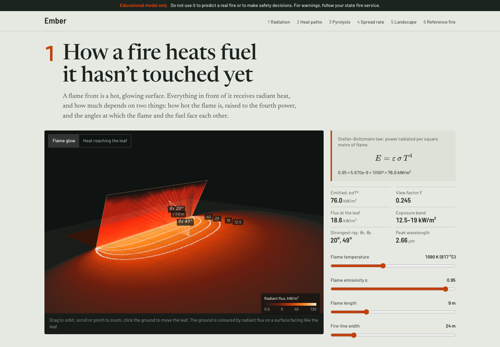
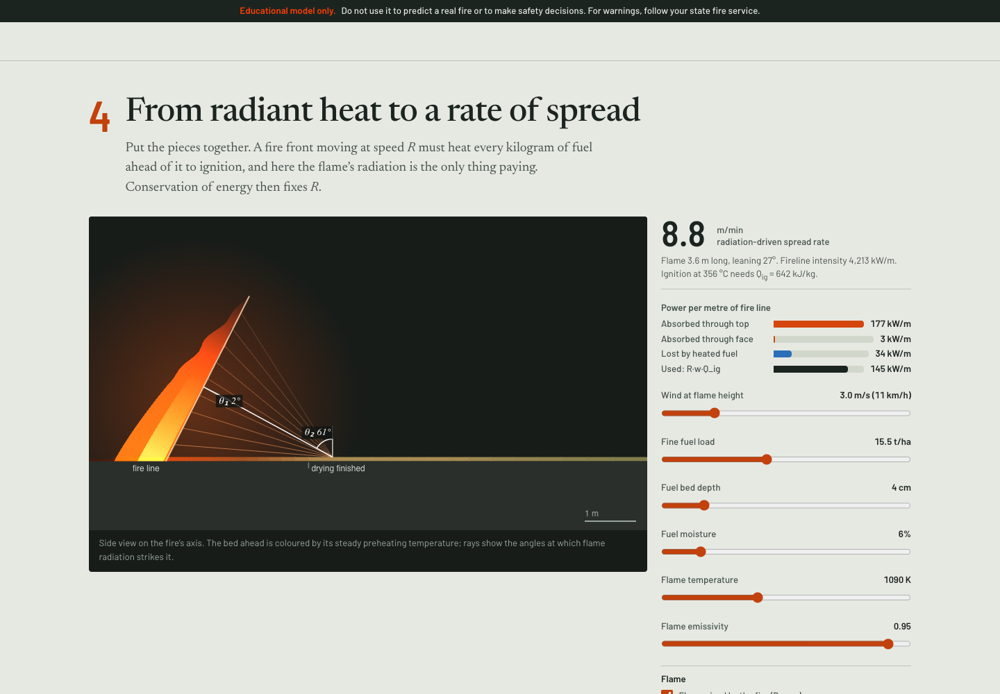

# ember

> An explorable model of bushfire physics, from Stefan–Boltzmann radiation to fire spread on real Canberra terrain.

[](https://github.com/Guinerve/ember/actions/workflows/ci.yml)

**v0.2:** six physics and landscape sections, a worker-based spread solver, and a published reference-fire comparison.

**Educational model only.** Do not use it to predict a real fire or to make safety decisions.



## What it shows

The page builds the physics up as a chain, one section per link:

1. **Radiation.** A 3D flame front radiates onto the ground. Flux is `q = εσT⁴·F`, with the view factor `F = ∫ cosθ₁ cosθ₂ / (πr²) dA` integrated over the flame. The flame is drawn in the colour Planck's law gives its temperature. The ground is contoured at the AS 3959 flux bands (12.5, 19, 29, 40 kW/m²). The strongest ray to the leaf is drawn with its angles θ₁ and θ₂, and a second mode colours the flame by how much each part of it heats the leaf.
2. **Heat paths.** Radiation, flame-contact convection and bed conduction against distance ahead of the fire line, plus radiation (∝ T⁴) against convection (∝ T).
3. **Pyrolysis.** One thermally thin leaf or twig: heating, a 100 °C drying stall, Arrhenius pyrolysis and ignition at a critical flammable-gas flux.
4. **Spread from first principles.** `R·w·Q_ig = α∫q dx + face radiation − losses`, solved for R. Byram's flame-length correlation optionally closes the loop between spread rate and flame size.
5. **Landscape.** McArthur Mk5 spread over a real DEM of the Brindabellas, as a 2D map or a 3D terrain view. Live assumptions sit beside the output.
6. **Reference fire.** Comparison against the Black Saturday Kilmore East fire (Cruz et al. 2012).



## Stack

TypeScript, Vite, three.js, KaTeX, Vitest; Python for DEM preprocessing. The landscape solve runs in a Web Worker.

The dev server binds to `0.0.0.0` on port **5194**, so it's reachable over Tailscale (`vite --host 0.0.0.0 --port 5194 --strictPort`).

Use Node **22.18 or later**. The repository remains private; no public deployment is claimed.

## Run it

```bash
npm ci
npm run dev                    # http://0.0.0.0:5194
npm test                       # 53 tests
npm run build                  # type check and static build in dist/
# Optional: uv run scripts/fetch_dem.py to regenerate the included DEM
```

## How I know it's right

53 tests (`src/*.test.ts`, `src/physics/physics.test.ts`). Terrain-loading tests reject HTTP failures, invalid metadata, and mismatched binary grids before the solver starts.

**Radiation and heat transfer**
- σT⁴ at 1,000 K = 56.7 kW/m².
- The numerical view factor matches two exact results within 1%:
  - a receiver facing a parallel rectangle (corner formula);
  - a horizontal element against an infinite upright strip, `½(1 − x/√(x²+L²))`.
- `∫q dx` onto the ground from an upright infinite flame equals `εσT⁴·L/2` exactly.
- Flux falls with distance and never exceeds the emitted power. A flame leaning over the fuel delivers more than 1.8× the flux of an upright one at the same spot.

**Leaf heating and pyrolysis**
- Energy is conserved in the leaf: at steady state, absorbed equals lost.
- The leaf holds at 100 °C while it dries.
- There is a critical flux: the leaf ignites at 80 kW/m² and not at 10 kW/m².
- A simulated 10 K/min TGA run peaks at the 345 °C calibration temperature.

**Spread from the energy balance**
- The budget closes: `R·w·Q_ig` equals absorbed minus lost.
- A flame cooler than the ignition temperature can never carry the fire.

**Reference case and map model**
- Our FFDI reproduces the Kilmore East published values of 106 and 155.
- Mk5 under-predicts the observed spread by 2.0× and 3.2×, matching the literature's 2–3×.
- On flat ground the map model's head fire runs at the Mk5 rate (within 5%), and its burnt shape has the model L/B (within 15%).
- The older checks still pass: FFDI hand calculation, symmetry, wind and slope behaviour, hillshade direction.

## Reference case: Kilmore East, 7 February 2009

Source: Cruz et al. (2012), *For. Ecol. Manage.* 284, 269–285. Weather is from Kilmore Gap AWS, fine fuel is 15.6 t/ha for dry sclerophyll forest with a low understorey, and the drought factor is 10.

| | 14:00–15:00 | 15:00–16:00 |
|---|---|---|
| Observed forward spread | 68 m/min | 153 m/min |
| FFDI (ours; published 106, 155) | 106 | 155 |
| McArthur Mk5 | 33 m/min | 48 m/min |
| 10% of wind speed (Cruz & Alexander 2019) | 77 m/min | 105 m/min |
| Radiation-only physics (section 4) | ~12 m/min | ~14 m/min |
| L/B, FBP Eq. 79 (observed ≈ 5) | 5.7 | 7.1 |

The radiation-only model falls short on purpose. Radiation preheats and dries fuel, but these runs were carried by flame contact, turbulence and dense spotting (see Finney et al. 2015).

## Changes in this version

- **Wind shape.** The `1 + 0.125·U` placeholder is replaced by Canadian FBP Eq. 79, `L/B = 1 + 8.729(1 − e^(−0.030U))^2.155`, which is fitted to Alexander's (1985) forest-fire shapes; CSIRO's Spark ellipse template points to the same source. It gives 5.7 at 46 km/h against an observed ≈ 5. The placeholder gave 6.75.
- **Spread kernel.** The kernel grows from 16 to 80 neighbours (every primitive step out to radius 5). With 16 directions, narrow wind-driven ellipses came out ~35% too narrow, because their widest point lies ~10° off the wind axis and the nearest kernel direction was 26.6°. A full solve now takes ~300 ms, so it moved to a Web Worker.
- **Failure handling.** Terrain-load errors are visible. Worker errors clear stale fire results and show a retry message. Queued weather changes do not render an older solve as the current one. Coordinate inputs are rounded to grid cells.

## Limits

No ember spotting, fire–atmosphere coupling or suppression. Weather is constant for 6 h, wind is uniform, and fuel is uniform and continuous. Mk5 is known to under-predict summer wildfire spread by 2–3×; CSIRO now recommends Vesta Mk 2 for dry eucalypt forest. The physics sections idealise the flame as a flat, uniform-temperature panel with no atmospheric absorption. Terrain is an SRTM-derived ~62 m grid (AWS Terrain Tiles), not ELVIS.

## Browser check

Checked in headless Chrome (puppeteer-core, SwiftShader WebGL) on 2026-10-13, in light and dark modes at 1440 px and 390 px. There were no console errors and no horizontal overflow at either width. Contribution mode, the 3D terrain view, Play and the Kilmore East button all work.

Additional Playwright checks confirmed the Kilmore East preset gives FFDI 106 and a flat-ground Mk5 rate of 33 m/min. Play, 2D/3D switching, clearing ignitions, and fractional coordinate entry work. An injected terrain HTTP 404 produces a visible alert. The mobile view has no horizontal overflow at 390 px.

## Next

- Add flame-contact convection to the section 4 energy balance, and compare with Vesta Mk 2.
- Use an ELVIS tile in place of the SRTM-derived one.
- Overlay a historical fire perimeter for a qualitative comparison.
- Refresh the demo GIF for the new page (the current one shows v0.1).

## Release checklist

- [x] Hero GIF or screenshot at the top of this README
- [x] Live demo link or one-command run (`npm install && npm run dev`)
- [x] "How I know it's right" section filled in with real results
- [x] CI test/build workflow and badge
- [x] "Limits" section written
- [x] MIT licence, repository description, and topics

Profile pinning and entries in `guinerve.github.io` and `career-radar/data/cv/portfolio.json` remain separate portfolio tasks.
