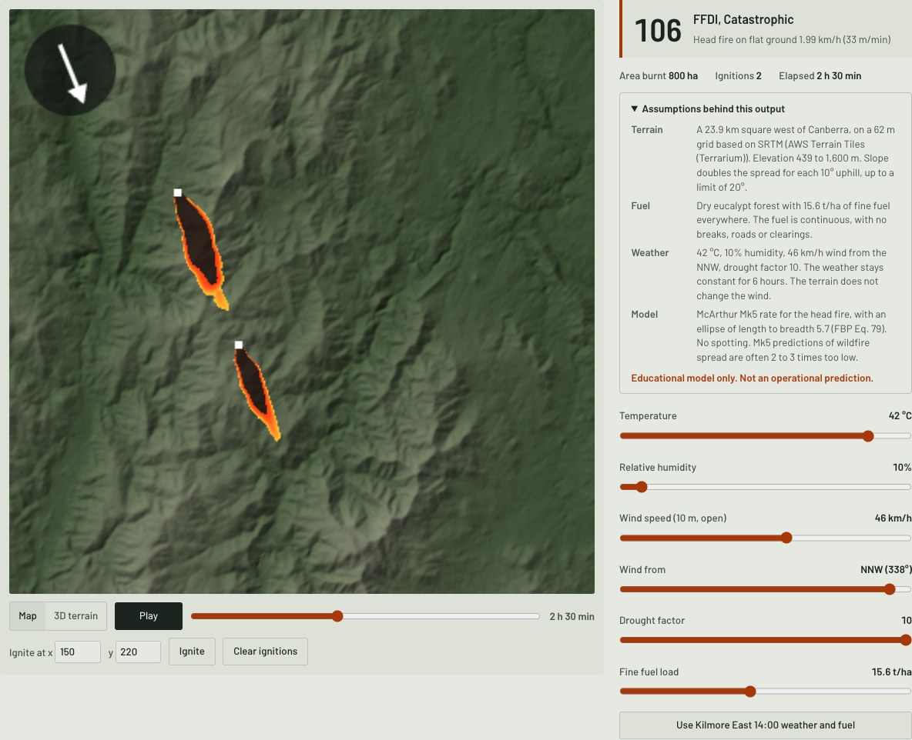
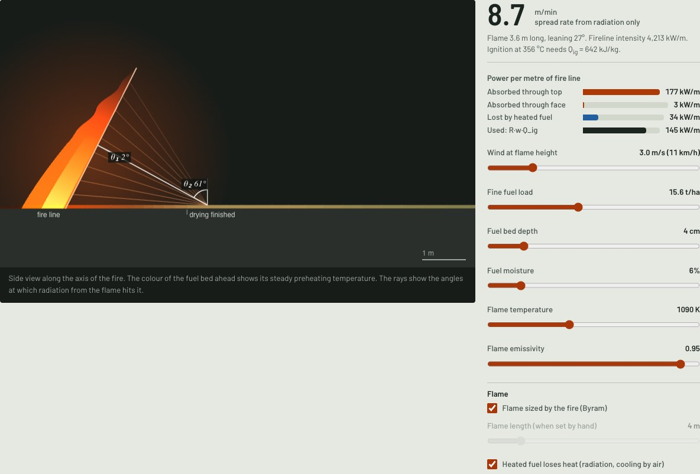

# ember

An interactive model of bushfire physics. It starts with the heat that one flame radiates and ends with fire spread on real terrain west of Canberra.

[](https://github.com/Guinerve/ember/actions/workflows/ci.yml)

**Educational model only.** Do not use it to predict a real fire or to make safety decisions. For warnings, follow your state fire service.

**[Open the live model](https://guinerve.github.io/demos/ember/)**



I built ember to understand why bushfires spread the way they do. Fire danger tables give a number, but they do not show the physics behind it. This page builds that physics one step at a time, from radiation to pyrolysis to a rate of spread. Then it runs McArthur's Mk5 forest model over a real elevation grid of the Brindabella Ranges. The last section compares every model with the measured spread of the Black Saturday Kilmore East fire.

## Quick start

You need Node 22.18 or later.

```bash
npm ci
npm run dev
```

Open http://localhost:5194. All the code runs in the browser. The elevation grid is already in `public/`.

## What the page shows

The page has six sections. The first three share one flame, and section 6 reuses the model from section 4.

1. **Radiation.** A 3D flame front radiates onto the ground. The flux is `q = εσT⁴·F`. The view factor `F = ∫ cosθ₁ cosθ₂ / (πr²) dA` is integrated over the flame. The flame has the colour that Planck's law gives for its temperature. Contours on the ground show the AS 3959 flux bands (12.5, 19, 29 and 40 kW/m²).
2. **Heat paths.** Radiation, convection from flame contact and conduction in the fuel bed, plotted against distance ahead of the fire.
3. **Pyrolysis.** One thin leaf or twig heats up. It stays at 100 °C while it dries, then breaks down by Arrhenius pyrolysis. It ignites when its flux of flammable gas reaches a critical value.
4. **Spread rate from physics.** The energy balance `R·w·Q_ig = α∫q dx + face radiation − losses` gives the spread rate R. As an option, Byram's correlation for flame length links the flame size to the spread rate.
5. **Landscape.** McArthur Mk5 spread over a real elevation grid, as a 2D map or a 3D terrain view. The assumptions behind each result are listed next to it.
6. **Reference fire.** A comparison with the Kilmore East fire of 7 February 2009 (Cruz et al. 2012).




## How it works

The physics is in `src/physics/`. The landscape model is in `src/ffdi.ts` and `src/spread.ts`.

- **View factor.** For a receiver that tilts only towards or away from the fire, the integral along the fire line has an exact solution. So only the integral up the flame is numerical.
- **Leaf heating.** The leaf is thermally thin, so it has one temperature. Heun's method advances that temperature in time. Pyrolysis advances exactly over each step.
- **Spread rate.** The model marches the heat balance from far ahead of the fire back to the fire line. It then finds the rate R by bisection. Losses by radiation and to the air are included.
- **Landscape.** Each cell burns at the earliest time it can be reached from an ignition. A step between cells takes its distance divided by the local rate of spread. That rate is the Mk5 head fire rate `R = 0.0012 · FFDI · w`, with a slope correction and an ellipse around the wind. The ellipse uses Equation 79 of the Canadian Fire Behavior Prediction System for its length to breadth ratio.
- **Search directions.** Each cell connects to 80 neighbours, out to 5 cells away. With only 16 neighbours, fires in strong wind came out about 35% too narrow.
- **Worker.** The landscape solve runs in a Web Worker, so the page stays responsive.

The elevation grid comes from AWS Terrain Tiles (SRTM data). It is 384 by 384 cells of 62 m, a 23.9 km square west of Canberra. `scripts/fetch_dem.py` downloads it again if you want to change the area (`uv run scripts/fetch_dem.py`).

## Comparison with the Kilmore East fire

Cruz et al. (2012) published the weather, fuel and measured spread of the Kilmore East fire, hour by hour. The weather is from the Kilmore Gap weather station. The fine fuel is 15.6 t/ha of dry sclerophyll forest with a low understorey. The drought factor is 10.

| | 14:00 to 15:00 | 15:00 to 16:00 |
|---|---|---|
| Observed forward spread | 68 m/min | 153 m/min |
| FFDI from this model (published: 106 and 155) | 106 | 155 |
| McArthur Mk5 | 33 m/min | 48 m/min |
| 10% of wind speed (Cruz and Alexander 2019) | 77 m/min | 105 m/min |
| Physics, radiation only (section 4) | 12 m/min | 14 m/min |
| Length to breadth, FBP Eq. 79 (observed about 5) | 5.7 | 7.1 |

The FFDI matches the published values. Mk5 predicts spread that is 2.0 and 3.2 times too slow. Published studies report 2 to 3 times for summer wildfires, so the second hour is a little above that range. The model with radiation only is slower still. Radiation preheats and dries the fuel, but flame contact, turbulence and dense spotting carried these runs (Finney et al. 2015).

## Tests

```bash
npm test         # 56 tests
npm run build    # type check and static build in dist/
```

The tests check the physics against exact results and published values:

- σT⁴ at 1,000 K is 56.7 kW/m².
- The numerical view factor matches two exact results within 1%. One is a receiver that faces a parallel rectangle. The other is a ground element next to an infinite upright strip, `½(1 − x/√(x²+L²))`.
- The flux onto the ground from an infinite upright flame integrates to exactly `εσT⁴·L/2`.
- The leaf conserves energy. It holds at 100 °C while it dries. It ignites at 80 kW/m² but not at 10 kW/m².
- A simulated 10 K/min heating test peaks at the 345 °C calibration temperature.
- The spread energy budget closes. A flame cooler than the ignition temperature never carries the fire.
- The FFDI gives the published Kilmore East values of 106 and 155.
- On flat ground, the map model's head fire runs at the Mk5 rate (within 5%). Its burnt shape has the model length to breadth ratio (within 15%).
- The terrain loader rejects HTTP errors, bad metadata and grids of the wrong size before the solver starts.

CI runs the tests and the build on every push.

## Limits

- No ember spotting, no coupling between the fire and the atmosphere, and no suppression.
- The weather stays constant for 6 hours. The wind is uniform, and the terrain does not change it.
- The fuel is uniform and continuous, with no roads, rivers or clearings.
- Mk5 predictions of summer wildfire spread are often 2 to 3 times too low. CSIRO now recommends Vesta Mk 2 for dry eucalypt forest.
- The physics sections treat the flame as a flat panel at one temperature, with no absorption by the air.
- The terrain is a 62 m grid based on SRTM, not the finer ELVIS data from Geoscience Australia.

## Stack

TypeScript, Vite, three.js, KaTeX and Vitest. Python (numpy, Pillow, httpx) for the elevation grid.

## Licence

MIT. See [LICENSE](LICENSE).
